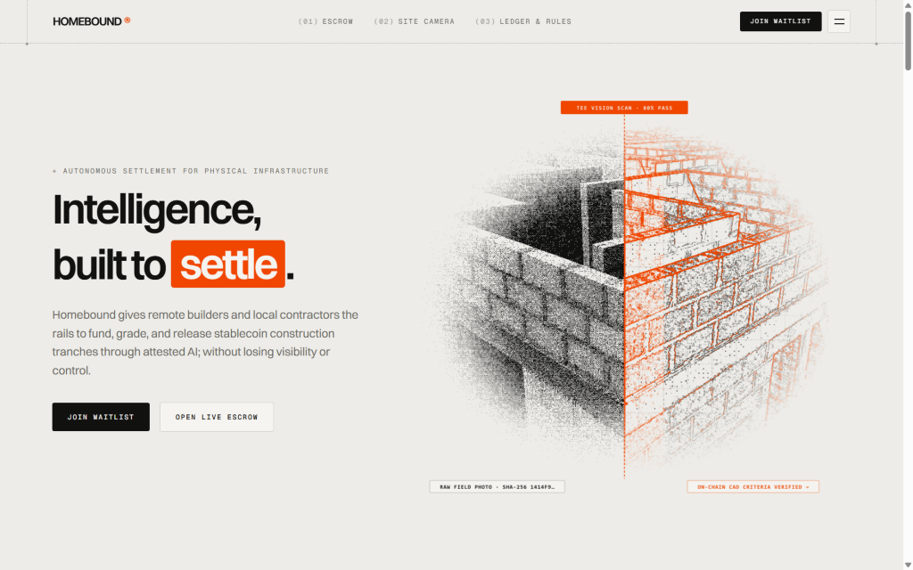
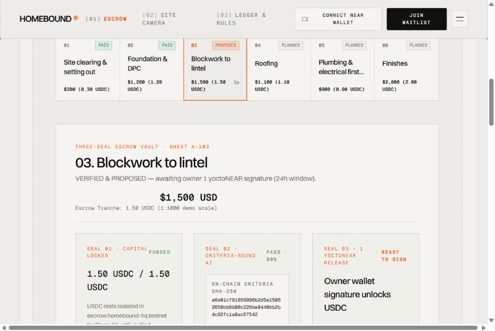
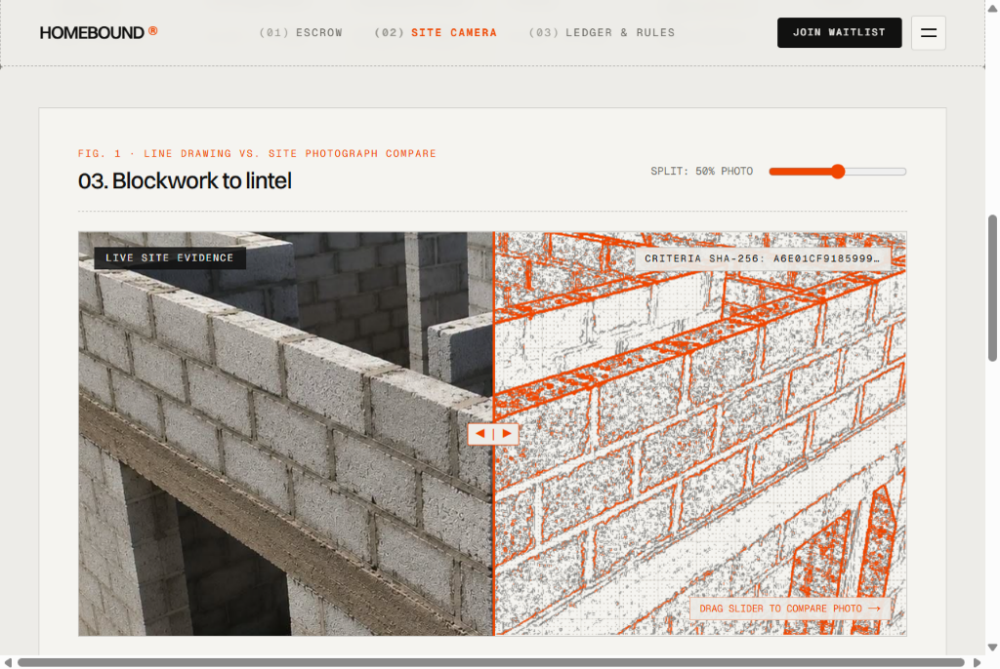
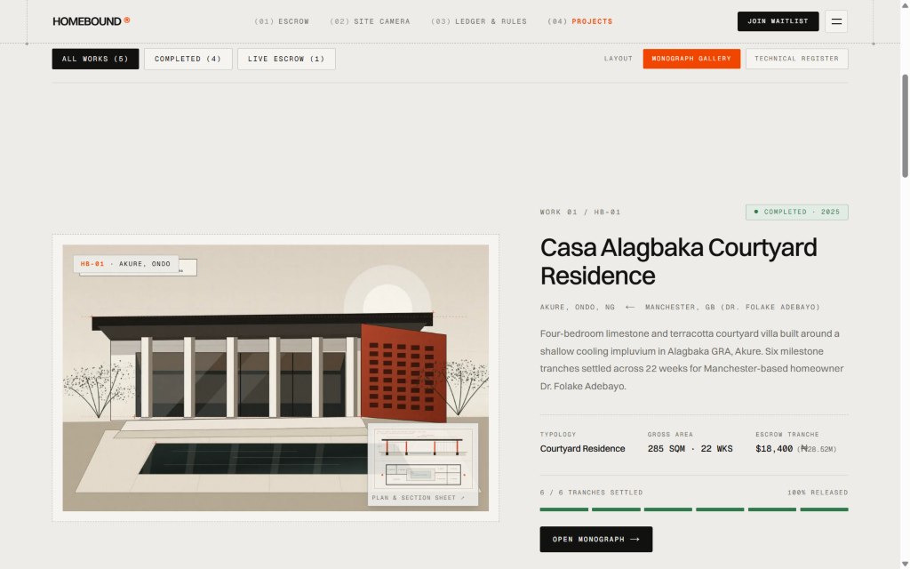
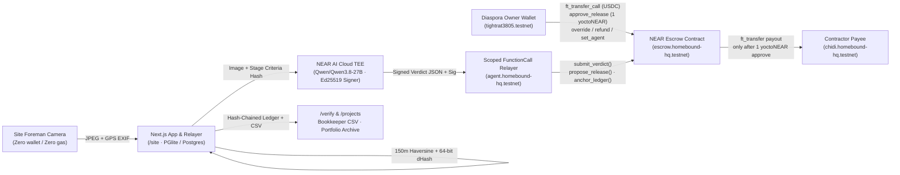

<p align="center">
  
</p>

<h1 align="center">HomeBound: Autonomous Settlement for Physical Infrastructure</h1>

<h3 align="center">Intelligence, built to settle.</h3>

> *"Foreman, is the ring beam poured on Stage 03?"*  
> *"Uploaded from Akobo 3 minutes ago — 18m inside your site boundary, graded **PASS (0.80 confidence)** by NEAR AI Cloud TEE against your `criteria_hash`. Tap Approve (`1 yoctoNEAR`) to settle **1.50 USDC** to Chidi."*

**HomeBound** gives diaspora builders and local contractors the infrastructure to fund, grade, and settle construction milestones in **Circle USDC on NEAR** (`escrow.homebound-hq.testnet`) — without losing visibility or ownership. A site foreman snaps raw progress photography with **zero gas or wallet setup**; **NEAR AI Cloud TEE Vision** (`Qwen/Qwen3.8-27B`) grades physical blockwork against each stage's on-chain `criteria_hash`; and USDC moves **only** when the remote homeowner signs with `1 yoctoNEAR`.

**Hackathon:** NEAR Hackathon  
**Targeted Tracks:** **`08 / Real-World Money`** (Stage-locked Circle USDC, gasless site relay, bookkeeper CSV exports) & **`13 / Open Innovation`** (Coordinated money + attested TEE intelligence + `1 yoctoNEAR` human sovereignty, public on-chain rules & escape hatches)  
**Deployed Escrow Contract:** [`escrow.homebound-hq.testnet`](https://testnet.nearblocks.io/address/escrow.homebound-hq.testnet)



| `(01)` Owner Escrow & Escape Hatches | `(02)` Gasless Site Camera & CAD Scan | `(03)` Bookkeeper Ledger · `(04)` Portfolio |
| --- | --- | --- |
|  |  |  |

---

## 🎯 The Single Narrative

Every module across the Rust smart contract, gasless Next.js relayer, PostgreSQL ledger, and architectural UI serves one end-to-end invariant:

```text
┌────────────────────────────────────────────────────────────────────────────────────────┐
│                                 THE HOMEBOUND PROTOCOL                                 │
│                                                                                        │
│  🚨 THE PROBLEM:          Diaspora builders wire lump sums abroad with zero proof.     │
│  ⚙️ THE HARD CORE:        6 stage-locked Circle USDC tranches on NEAR Testnet Rust.    │
│  👷 ZERO-GAS FIELD UX:    Foreman uploads EXIF photos via scoped gas-sponsored relayer.│
│  🧠 ATTESTED TEE BRAIN:   Geofence + dHash barrier + Qwen3.8-27B Ed25519 TEE verdict.  │
│  🔑 HUMAN SOVEREIGNTY:    Agent can propose (7d TTL), ONLY homeowner 1 yoctoNEAR pays. │
└────────────────────────────────────────────────────────────────────────────────────────┘
```

---

## 1. 🚨 The Problem: Blind Remittances & Unverified Concrete

Diaspora homeowners send billions home annually to build residences, yet traditional remittance flows force binary trust onto remote builders:
- **Lump-sum wires lock zero accountability:** Once bank or mobile-money funds leave London, Toronto, or Houston, the homeowner cannot recall unspent tranches if a contractor stalls or substitutes inferior blockwork.
- **Photos without provenance are easy to forge:** WhatsApp images stripped of EXIF coordinates or recycled across multiple billing weeks routinely fool remote families.
- **Foremen cannot onboard onto crypto wallets:** Expecting a bricklayer on a dusty site in Ibadan or Akure to install a browser wallet, manage seed phrases, and buy NEAR for gas stops adoption cold.

---

## 2. 🧭 What It Does: Five Surfaces, One Verifiable Loop

| Route | Surface Title | Actor | Contract / Backend Verbs | What Happens |
| :--- | :--- | :--- | :--- | :--- |
| `/` | **Overview** | Everyone | `getChainProject()` · `joinWaitlistAction()` | Explains the `Observe → Reason → Move` loop, live 6-stage stack, exploded axonometric cut, and corridor waitlist persisted to the hash-chained ledger. |
| `/build` | **`(01) ESCROW`** | Homeowner (`tightrat3805.testnet`) | `ft_transfer_call`, `approve_release`, `override_release`, `refund_stage`, `set_agent` | Fund tranches stage-by-stage in Circle USDC, toggle `USDC / ₦ NGN`, execute `1 yoctoNEAR` payout approvals, or trigger public escape hatches anytime. |
| `/site` | **`(02) SITE CAMERA`** | Site Foreman (no wallet needed) | `submitEvidenceAndVerify()` → `submit_verdict`, `propose_release` | Captures or drops raw JPEG site photos with zero NEAR balance. Enforces EXIF geofence & dHash dedup, morphs photo against CAD linework, calls TEE Vision, and records proof on-chain. |
| `/verify` | **`(03) LEDGER & RULES`** | Bookkeeper / Auditor | `GET /api/ledger/csv` · `anchor_ledger` · `verifyLiveTeeAttestationAction()` | Inspects hash-chained events, exports RFC-4180 CSV with trusted payment statuses, verifies live TEE Ed25519 keys, and audits failure-recovery rules. |
| `/projects` & `/projects/[slug]` | **`(04) PROJECTS`** | Architects & Clients | `getAllPortfolioProjects()`, `getPortfolioProjectBySlug()` | PostgreSQL-backed archive of completed diaspora residences (`HB-01`..`HB-04`) and active Akobo flagship (`HB-05`), each with bespoke orthographic section sheets and settled receipts. |

---

## 3. ⚙️ The Hard Core: Three Coordinated Engines

### Engine 1: Stage-Locked Circle USDC & Scoped Gasless Relay (`contracts/escrow/src/lib.rs`)
- **Stage-Sequential Vault:** Projects decompose into ordered stages (`01` Site Clear → `06` Handover). Circle USDC enters each stage strictly via NEP-141 `ft_transfer_call` and pays `chidi.homebound-hq.testnet` only in dependency order. Any over-funding is returned automatically via `ft_on_transfer`.
- **Least-Privilege Field Relayer:** `agent.homebound-hq.testnet` holds a **FunctionCall-only key** on NEAR strictly scoped to `submit_verdict`, `propose_release`, and `anchor_ledger`. It sponsors gas for site foremen while physically lacking permission to withdraw or transfer USDC.

### Engine 2: Anti-Fraud Vision Pipeline & Cryptographic `ref` Binding (`src/lib/evidence/`, `src/lib/ai/`)
Before a single token moves, every uploaded site photograph crosses three deterministic barriers and one TEE signature check:

1. **Haversine Geofence Gate (`src/lib/evidence/image.ts`):** Parses raw JPEG GPS EXIF coordinates and rejects uploads farther than **$150\text{ m}$** (configurable per project) from site datum coordinates:
   $$d = 2R \arcsin\left(\sqrt{\sin^2\left(\frac{\Delta\phi}{2}\right) + \cos\phi_1 \cos\phi_2 \sin^2\left(\frac{\Delta\lambda}{2}\right)}\right) \le r_{\text{site}}$$
2. **Perceptual Recycling Barrier (64-bit dHash):** Computes a difference-hash fingerprint and compares Hamming distance $\Delta_H$ against every previously accepted evidence photo on the project, blocking cropped or re-saved images from earlier weeks.
3. **4-Part `criteria_hash` Binding (`submit_verdict`):** Inside NEAR AI Cloud (`Qwen/Qwen3.8-27B`), the TEE returns a deterministic structured JSON response signed with the enclave's hardware-backed Ed25519 key over `"{model_id}:{request_hash}:{response_sha256}"`. On-chain in Rust, `submit_verdict` verifies the registered Ed25519 signature (`ed25519-dalek` / `env::ed25519_verify`), prevents `response_hash` replay, and requires the signed JSON `ref` to match:
   $$\text{ref} = \texttt{"\{project\_id\}/\{stage\}/\{criteria\_hash\}/\{evidence\_sha256\}"}$$

### Engine 3: `1 yoctoNEAR` Ownership & Sovereign Escape Hatches
The TEE agent can call `propose_release(project_id, stage)`, creating a release proposal with a **7-day expiration (`PROPOSAL_TTL_NS = 7 days`)**. It can **never** call `approve_release`. Final Circle USDC settlement executes only when the homeowner attaches `1 yoctoNEAR` via NEAR Wallet (`@hot-labs/near-connect`).

---

## 4. 🛡️ Public On-Chain Rules & Failure-Case Recovery

| Failure Mode | On-Chain Rule (`contracts/escrow/src/lib.rs`) | Recovery Action |
| :--- | :--- | :--- |
| **TEE rejects valid work / AI cloud stalls** | `override_release(project_id, stage, reason)` | Owner attaches a public inspection note (e.g., surveyor sign-off) and releases USDC (`1 yoctoNEAR`). |
| **Contractor abandons funded milestone** | `refund_stage(project_id, stage)` | Owner sweeps funded, unreleased Circle USDC back to their wallet (`1 yoctoNEAR`). |
| **7-day release proposal goes stale** | `PROPOSAL_TTL_NS = 7 * 24 * 60 * 60 * 1_000_000_000` | Expired proposals panic on `approve_release`; foreman must re-submit a fresh photo or owner refunds. |
| **Relayer FunctionCall key compromised** | `set_agent(project_id, new_agent)` | Owner immediately rotates or freezes the project's relayer account (`1 yoctoNEAR`). |
| **Failed re-grade after an earlier Pass** | `submit_verdict` resets `proposal = None` | A later failing or low-confidence verdict invalidates any stale pending proposal automatically. |

---

## 5. 🏛️ System Architecture



### Repository Layout

```text
contracts/
└── escrow/
    ├── src/lib.rs                  # NEAR SDK 5 escrow contract, Ed25519 TEE verification, escape hatches
    ├── src/verdict.rs              # Signed JSON verdict & 4-part ref parser
    └── tests/fixtures/             # Captured live NEAR AI Cloud TEE signed completion fixture
src/
├── app/
│   ├── page.tsx                    # Overview landing page
│   ├── build/page.tsx              # (01) Owner escrow vault, 1 yoctoNEAR approval & escape hatches
│   ├── site/page.tsx               # (02) Gasless foreman upload studio, geofence & CAD compare slider
│   ├── verify/page.tsx             # (03) Hash-chained audit ledger, rules matrix & CSV download
│   ├── projects/                   # (04) Portfolio archive index & [slug] architectural monographs
│   ├── actions/                    # Server Actions bridging PGlite/Postgres, NEAR AI TEE & NEAR RPC
│   └── api/                        # /api/attestation, /api/blobs/[key], /api/health, /api/ledger{,/csv}
├── components/                     # BuildWorkspace, SiteStudio, GeofenceRadar, Header, Monograph views
├── db/
│   ├── schema.ts                   # Drizzle PostgreSQL schema (projects, parties, stages, evidence, payments, ledger)
│   ├── index.ts                    # Embedded PGlite / external Postgres connection + idempotent schema migrations
│   ├── portfolio-seed-data.ts      # Completed diaspora residences (HB-01..HB-04) & Akobo (HB-05) specs
│   └── seed.ts                     # Idempotent seeding & testnet tx synchronization
└── lib/
    ├── ai/                         # NEAR AI Cloud TEE client + Ed25519 signature verifier
    ├── evidence/                   # EXIF GPS extractor, Haversine geofence check & 64-bit dHash dedup
    ├── flows/                      # End-to-end evidence submission, funding & settlement orchestrators
    ├── near/                       # NEAR RPC views & FunctionCall relayer signing
    └── queries.ts                  # Server queries joining PostgreSQL ledger with live chain state
scripts/
├── attack.mjs                      # 8-check cryptographic tamper, replay, signer & key-scope red-team suite
└── nearai-spike.mjs                # Live NEAR AI Cloud TEE signature diagnostic probe
docs/media/                         # Verified UI & architectural screenshots
public/
├── logos/                          # 4 high-resolution HomeBound brand & emblem variants
├── art/                            # Hero TEE scan morph, exploded axonometric stages & CTA pavilion
└── projects/                       # 12 bespoke perspective, orthographic CAD section & detail plates
```

---

## 6. ⛓️ Live NEAR Testnet Deployment (`hb-akobo-bungalow-v2`)

| Component | Testnet Identifier / Model | Explorer / Verification |
| :--- | :--- | :--- |
| **Escrow Contract (Rust)** | `escrow.homebound-hq.testnet` | [View Contract](https://testnet.nearblocks.io/address/escrow.homebound-hq.testnet) |
| **Live Demo Owner** | `tightrat3805.testnet` | [View Account](https://testnet.nearblocks.io/address/tightrat3805.testnet) |
| **Scoped Gasless Agent** | `agent.homebound-hq.testnet` | [View FunctionCall Key](https://testnet.nearblocks.io/address/agent.homebound-hq.testnet) |
| **Nigeria Builder Payee** | `chidi.homebound-hq.testnet` | [View Payee](https://testnet.nearblocks.io/address/chidi.homebound-hq.testnet) |
| **Circle USDC (Testnet)** | `3e2210e1184b45b64c8a434c0a7e7b23cc04ea7eb7a6c3c32520d03d4afcb8af` | [View Token](https://testnet.nearblocks.io/address/3e2210e1184b45b64c8a434c0a7e7b23cc04ea7eb7a6c3c32520d03d4afcb8af) |
| **NEAR AI Cloud TEE Model** | `Qwen/Qwen3.8-27B` | Registered Ed25519 pubkey `89154a43...30cb2d93` |

### Verified On-Chain Transaction Receipts (`hb-akobo-bungalow-v2`)

- **Project Created (`create_project`):** [`HCgdx6HM...n46y4e`](https://testnet.nearblocks.io/txns/HCgdx6HMJTnc8LXJkGNLoDYMn3JcWPfWPQJCGYn46y4e)
- **Stage 01 (`Site clearing & setting out`):** Fund [`9a3GCDth...orv4crZ`](https://testnet.nearblocks.io/txns/9a3GCDthu2oVfpAJcjDmpYYYetSoV86xS4KQLorv4crZ) · Settled [`2gmDDiKY...Ukenh4G`](https://testnet.nearblocks.io/txns/2gmDDiKYD2NZa2NZPyFZT4tCCtRJXKozMtv22Ukenh4G)
- **Stage 02 (`Foundation & DPC`):** Fund [`TpzxN6hy...dSRfyp`](https://testnet.nearblocks.io/txns/TpzxN6hyqKo47MXoE1oYKBDqEWFz4Za6uJCp4dSRfyp) · Settled [`ApzRwzd5...GTfPQGP2`](https://testnet.nearblocks.io/txns/ApzRwzd58MgyxZz6uM2ufSbTQ9rvcHZGm5rZGTfPQGP2)
- **Stage 03 (`Blockwork to lintel` — Active):** Funded [`PW1xrcYm...9bzPD`](https://testnet.nearblocks.io/txns/PW1xrcYmz8LydDTc3eQ834tKhz7J1xBDkectu29bzPD)

*(Testnet demo scaling uses `NEAR_DEMO_DIVISOR = 1000`, so `1.50` USDC on-chain represents `$1,500` USD stage value cleanly within faucet liquidity.)*

---

## 7. 🧪 Verification & Adversarial Security Suite

### Smart Contract Unit Tests (`34 passed; 0 failed`)
Includes cryptographic signature tests against a captured real NEAR AI Cloud TEE response, tampering resistance, criteria-hash binding mismatches, replay rejection, `PROPOSAL_TTL_NS` expiry, and owner sovereignty checks:
```bash
npm run contract:test
# -> test result: ok. 34 passed; 0 failed; 0 ignored
```

### Adversarial Red-Team & Live Testnet Key Audit (`8 passed`)
Tests signature tampering (`fail -> pass` rejected), stale `response_hash` rejection, cross-stage photo replay, forged Ed25519 keys, plus live NEAR RPC checks confirming the registered TEE pubkey on `escrow.homebound-hq.testnet` and the restricted FunctionCall key on `agent.homebound-hq.testnet`:
```bash
npm run attack
# [PASS] Baseline captured NEAR AI Cloud TEE verdict verifies end-to-end
# [PASS] Tampered response body ('fail' -> 'pass') with original signature is rejected
# ...
# [PASS] Live agent agent.homebound-hq.testnet has FunctionCall key scoped to escrow.homebound-hq.testnet
# 8 red-team checks passed.
```

---

## 8. 🚀 Quickstart (For Judges)

```bash
# 1. Clone & install
git clone https://github.com/emarc99/HomeBound-near.git
cd HomeBound-near
npm install

# 2. Configure environment (uses embedded PGlite if DATABASE_URL is omitted)
cp .env.example .env.local
# Add NEARAI_API_KEY + NEAR_AGENT_PRIVATE_KEY to enable live TEE grading & relayer writes

# 3. Verify types, lint, build & launch
npx tsc --noEmit
npm run lint
npm run build
npm run dev
```

Open **`http://localhost:3000`**:
1. Inspect **`/projects`** (`(04) PROJECTS`) to browse completed diaspora architectural monographs (`HB-01` through `HB-04`) and the live Akobo flagship (`HB-05`).
2. Visit **`/site`** (`(02) SITE CAMERA`), drag the **CAD Contour vs. Site Photo** compare slider, and run a sample inspection (`Cast Lintel Beam`) through NEAR AI Cloud TEE.
3. Visit **`/build`** (`(01) ESCROW`) to inspect stage tranches in `USDC / ₦ NGN` and view `1 yoctoNEAR` settlement controls & public escape hatches.
4. Visit **`/verify`** (`(03) LEDGER & RULES`) to download **`GET /api/ledger/csv`** and run **`Verify Live TEE Attestation`**.

---

## 9. 🏆 Hackathon Context & Baseline Disclosure

- **Targeted Tracks:** **`08 / Real-World Money`** & **`13 / Open Innovation`** (NEAR Hackathon).
- **Baseline Disclosure:** Built from a clean milestone scheduling schema originally explored in an unsubmitted PayPal/Postgres prototype ([`emarc99/HomeBound`](https://github.com/emarc99/HomeBound), started Nov 3, 2026), re-architected around NEAR Circle USDC escrow (`contracts/escrow`), on-chain Ed25519 TEE verification via NEAR AI Cloud, criteria-hash binding, scoped gasless FunctionCall keys, architectural monograph portfolio routes (`/projects`), and an ARCA-inspired CAD web interface.

---

## 10. License

MIT License. Built with verifiable precision on NEAR Protocol.
